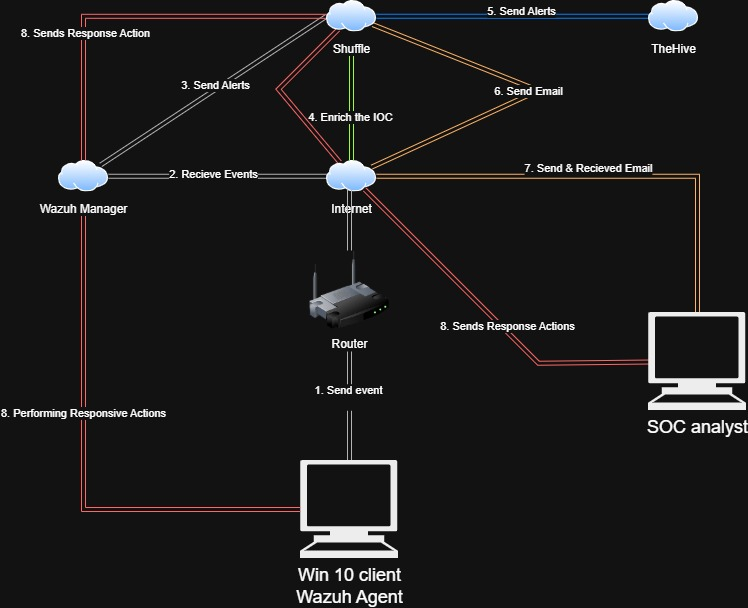
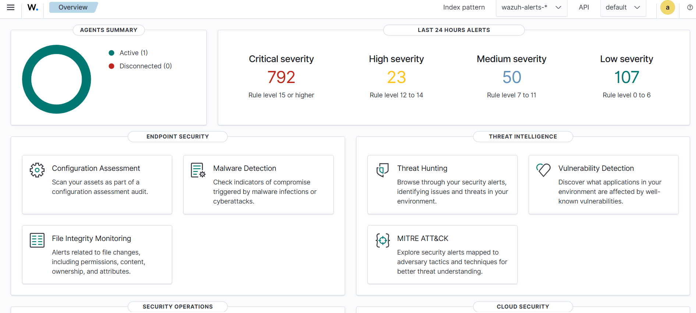
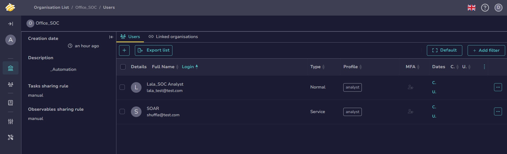
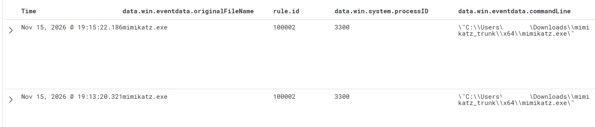
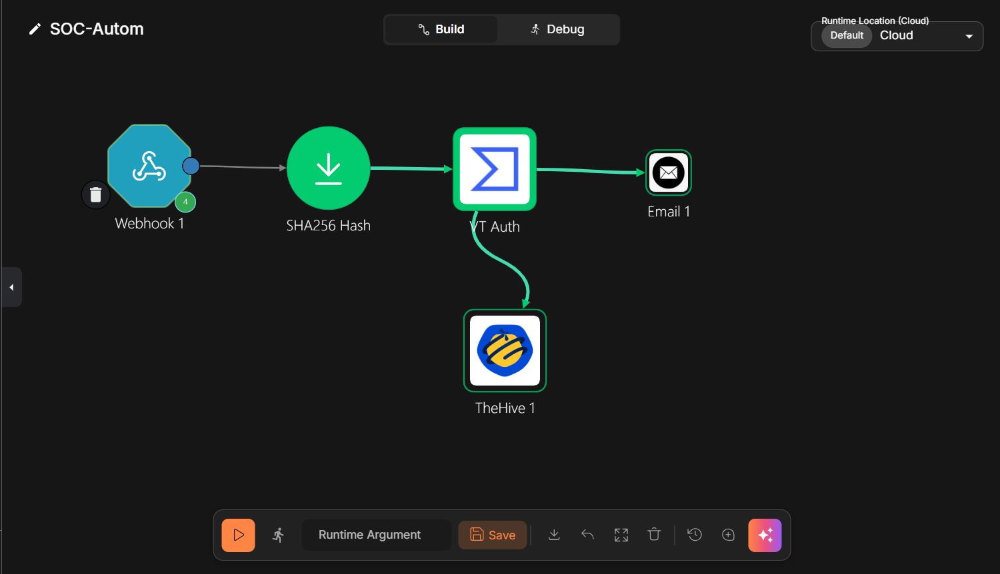
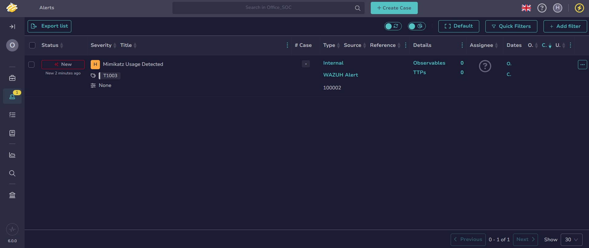
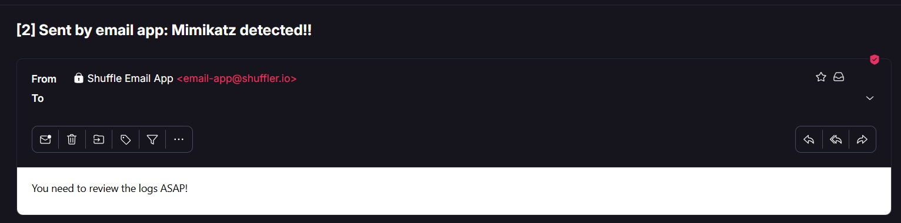

# SOC Automation SIEM Detection

## Objective

Build a detection lab on Microsoft Azure that simulates a cyberattack and detects it the way a Security Operations Center (SOC) analyst would see it. Primary focus was to collect endpoint logs, write custom detection rules, and automate the flow so that important, high-priority alerts from the Security Information and Event Management (SIEM) system reach the analyst in a structured form, using Security Orchestration, Automation and Response (SOAR). This hands-on experience was to deepened understanding of SIEM detection rules and SOAR workflows, while keeping the cloud environment secured with restricted network access.

### Skills Learned

- Deploying cloud virtual machines on Azure. With controlled access with Network Security Groups.
- Advanced understanding of SIEM concepts and practical application. By (in this case) installing and configuring a SIEM (Wazuh) and enrolling a Windows agent in virtual machine.
- Collecting endpoint telemetry with Sysmon.
- Writing custom Wazuh detection rules (XML and regex) and mapping them according to MITRE ATT&CK.
- Building SOAR workflows in Shuffle (webhooks, API calls, JSON handling)
- Setting up TheHive with Cassandra and Elasticsearch, and using service accounts with API keys.
- Enriching alerts with the VirusTotal API.
- Linux administration: systemd services, file permissions and log analysis.
- Step-by-step troubleshooting: service, port, network, authentication and data.

### Tools Used

- Microsoft Azure,	Two private virtual machines, one for Wazuh and one for TheHive
- Wazuh	SIEM: log collection, detection and alerting
- Sysmon Windows process events
- Windows 11 (virtual machine)	Monitored endpoint, with the Wazuh agent installed.
- Shuffle	SOAR, For automation workflow.
- TheHive [6.0.0]	Case and alert management
- Cassandra [4.1.12]	TheHive database
- Elasticsearch [8.19.25]	TheHive search index

## Steps
With these diagram as follow, these are the steps that went down.

*Ref 1: Automation Diagram*

1. Deploy the Wazuh server (Azure VM 1).

Created an Azure VM, installed Wazuh, and restricted the dashboard and SSH ports to my own IP in the Network Security Group.

*Ref 2: Wazuh interface*

2. Connect the Windows 11 endpoint.

Installed the Wazuh agent and Sysmon on a Windows 11 virtual machine, opened ports 1514 and 1515 for the agent's IP only, and confirmed that the agent showed as Active.

3. Deploy TheHive (Azure VM 2).

Installed Cassandra, Elasticsearch and TheHive on a second VM. Elasticsearch runs in single-node mode and, like Cassandra, listens on 127.0.0.1 only. TheHive's port is reachable only from my IP.

*Ref 3: TheHive with dummy-analyst users*

4. Write the detection rule.

Created a custom Wazuh rule that triggers on a Sysmon process-creation event using the original file name (in this case) is Mimikatz.

*Ref 4: Mimikatz successfully discovered*

5. Build the Shuffle workflow

- Webhook receives the Wazuh alert
- The SHA256 value is extracted from the Sysmon hash field
- VirusTotal returns the reputation of the hash
- A TheHive alert is created through a service account (API key)
- An email notification is sent

*Ref 5: Shuffle Workflow*

6. Test the whole chain

Ran a test in resulting: the Mimikatz test triggered the custom rule, the hash was checked on VirusTotal, TheHive created the alert, and the notification email received.

*Ref 6: Email & Notification recieved*
The workflow ran as intended. It can be extended with more detection rules, more endpoints and response actions to fit different needs.
__________________________________________________________________
Problems and How I Solved Them

- Problem: Wazuh agent could not register.
- Solve: Azure's Network Security Group blocked ports 1514 and 1515, even though the server's own firewall allowed them. So an inbound Network Security Group rule created for ports 1514 and 1515, limited to the agent's IP address.

- Problem: Cassandra did not start after the VM restarted
- Solve: The Cassandra data folders were owned by root instead of the cassandra user, so the service was not allowed to write to them. Now, restored the correct ownership with chown, and now start the service only through systemctl. I also configured TheHive to wait for Cassandra and Elasticsearch and to retry automatically if it fails, so the services recover after a restart.

__________________________________________________________________
And lastly, on that note: why I did not include *Suricata* (IDS) in this project: This lab focuses on endpoint detection (Wazuh and Sysmon). Suricata, a network intrusion detection and prevention system (IDS/IPS), would add network-level visibility for port scans and known malicious traffic.

I left it out of this project because an untuned Suricata produces a large number of low-priority alerts, and too many noise which would bury the Mimikatz detection that this project demonstrates. The goal here was to show that the endpoint is monitored and that an alert flows through the whole workflow until it reaches the analyst by email.
